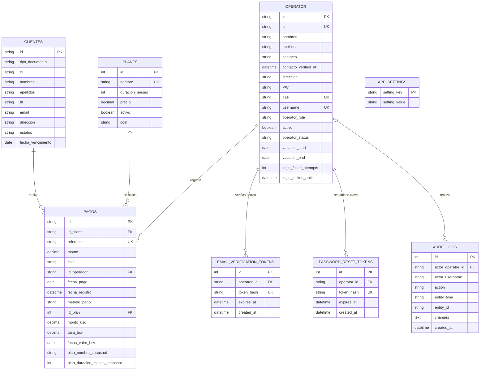

# Diagrama entidad-relación

El diagrama corresponde a las tablas definidas en [`database/schema.sql`](../database/schema.sql).
La versión gráfica descargable está en [diagrama-er.svg](../diagrama-er.svg).
`PK` y `UK` indican claves primarias y únicas declaradas en SQL. Las relaciones
representan asociaciones utilizadas por la aplicación: el esquema actual no
declara restricciones `FOREIGN KEY`, por lo que la base de datos no las hace
cumplir automáticamente.

En `PAGOS`, `id_plan` es opcional; sus campos `plan_*_snapshot` conservan la
información del plan al registrar el pago. `AUDIT_LOGS.actor_operator_id`
también es opcional. `PASSWORD_RESET_TOKENS.operator_id` está definido como
`VARCHAR(64)`, mientras que `OPERATOR.id` es `CHAR(36)`; la aplicación los
relaciona por valor, pero SQL no valida esa correspondencia.

`APP_SETTINGS` no tiene relaciones con otras tablas.
En `CLIENTES`, la unicidad está definida para el par
`(tipo_documento, ci)`, no para `ci` por separado.

En `PAGOS`, `fecha_pago` representa el día en que ocurrió la transacción y
`fecha_registro` conserva el momento exacto en que fue guardada por el sistema.
